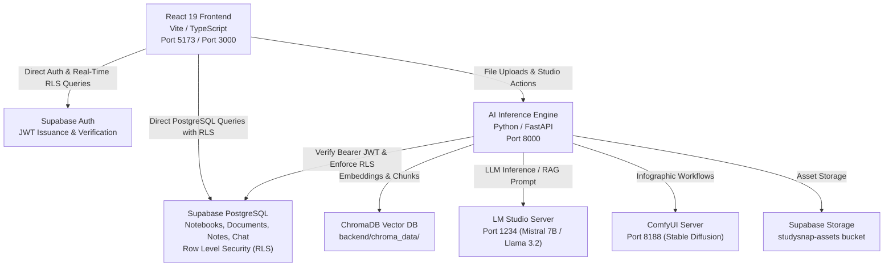

# StudySnap AI — System & Data Architecture

## 1. System Overview

StudySnap AI is a modern academic assistant architecture combining **Supabase** (Auth, PostgreSQL, Row Level Security, Storage), a specialized **FastAPI AI/RAG Engine**, local vector retrieval via **ChromaDB**, local LLM inference via **LM Studio**, and a responsive **React 19 / TypeScript** single-page application.

MongoDB has been completely removed in favor of Supabase PostgreSQL and Row Level Security.

---

## 2. Layer Architecture & Responsibilities

### 2.1. Presentation Layer (Frontend)
- **Framework:** React 19, TypeScript, Vite.
- **Styling:** Vanilla CSS design tokens with glassmorphic aesthetic and dark mode.
- **Authentication & Security:**
  - `@supabase/supabase-js` client instance initialized in `src/config/supabase.ts`.
  - Automatic session restoration and token syncing across refreshes.
  - `AuthModal.tsx`: Email/password registration, login, logout, and password recovery (`resetPasswordForEmail`).
- **Workspace & Dashboard:**
  - `StudentDashboard.tsx`: Real-time notebook history from Supabase with loading, error, and empty states.
  - `App.tsx`: Debounced autosave (1200ms) with visible saving/saved/error status indicators.

### 2.2. AI & RAG Engine Layer (`backend`)
- **Runtime:** Python 3.12, FastAPI, Uvicorn.
- **Supabase Integration:**
  - `auth.py`: Decodes Supabase Bearer JWT tokens, extracts authenticated user UUID (`sub`), checks token expiration, and prevents unauthorized cross-user access.
  - `database/connection.py`: Supabase client manager (`supabase-py`) with token propagation for PostgREST RLS.
  - `database/crud.py`: CRUD operations for notebooks, documents, notes, chat sessions, and generated materials.
- **AI Pipelines:**
  - Multi-format document ingestion: PDF, DOCX, PPTX, XLSX, CSV, Web URLs, YouTube transcripts, and audio lecture recordings (Whisper).
  - Document chunking: Recursive character splitting with chunk size 800 and overlap 150.
  - Vector embeddings and persistent storage in ChromaDB (`backend/chroma_data/`).
  - Retrieval-Augmented Generation (RAG) with local LLM serving (LM Studio port 1234).
  - Audio podcast dialogue generation (Edge TTS / Whisper).
  - Mind map generation (concept tree JSON for React Flow).
  - Infographic generation (ComfyUI Stable Diffusion workflow).

---

## 3. Data Protection & Row Level Security (RLS)

1. **Authentication:** All protected endpoints require a valid Supabase Bearer JWT.
2. **PostgreSQL RLS:** Every table (`profiles`, `notebooks`, `documents`, `notes`, `chat_sessions`, `chat_messages`, `generated_materials`) enforces `auth.uid() = owner_id`.
3. **Storage RLS:** Private storage bucket `studysnap-assets` scopes access to the authenticated user's folder (`auth.uid()::text = (storage.foldername(name))[1]`).
4. **Vector Isolation:** Chunks stored in ChromaDB are tagged with `file_id` and document metadata linked to the owner's Supabase document record.
